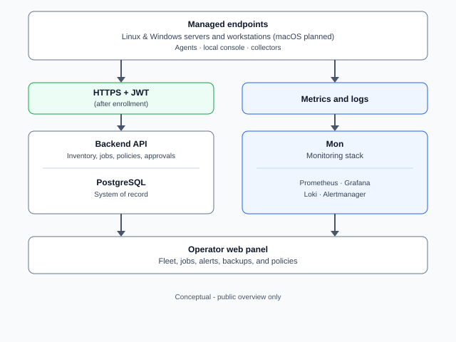

# RMM System

Remote Monitoring and Management stack for **Linux servers**: a lightweight **agent** on each host and a central **backend API** with a relational database. The workspace is split into focused repositories (agent, backend, compose stack, documentation).

Built and maintained as part of real-world infrastructure and production environments.

> Public overview repository. Source code and production infrastructure are private.

## What it does

- **Registers and authenticates agents** using pairing codes, bootstrap tokens, and mutual TLS with JWT fallback (as implemented in the private repos).
- **Executes remote jobs**: commands, package-oriented tasks, and system operations initiated from the control plane—**live operational use** on managed Linux fleets, not a lab-only prototype.
- **Runs automated security-oriented checks** on managed hosts (e.g. SSH configuration, listening ports, accounts, kernel reporting—scope is defined in the private codebase).
- **Collects heartbeats and status** so operators can see which devices are online and healthy.
- **Packages the agent** as a Debian `.deb` with a systemd unit for installation on Ubuntu/Debian-style targets.
- **Supports containerized bring-up** of the control plane via Docker Compose (private definitions), alongside production-style agent deployment paths.

## Why it exists

Teams need **real** remote monitoring, remediation, and automation on **Linux servers**—inventory, health, jobs, and hardening signals in one place. This stack keeps the **agent minimal (Go)** and the **control plane in Go + PostgreSQL** so operations stay predictable at scale without tying every workflow to a single vendor product.

## Key Features

- Secure agent lifecycle: pairing, registration, and credential model documented in the private tree.
- Job execution and scheduling concepts exposed through the backend API.
- Security scanning modules (configuration and surface-area checks).
- Near real-time monitoring via heartbeats and device metadata.
- **mTLS** and **JWT** patterns for agent-to-server trust.
- Debian packaging and systemd integration for the agent.
- Docker-based local bring-up for the backend stack.

## Architecture Overview

- **Agent** — Go daemon on managed Linux hosts; communicates with the backend; local persistence and packaging under `packaging/` in the agent repo.
- **Backend / API** — Go HTTP service (Gorilla Mux, PostgreSQL via `pgx`), configuration via Viper; persists agents, jobs, and operational state.
- **Database** — PostgreSQL as the system of record.
- **Orchestration** — Docker Compose definitions for running the backend and dependencies (private repo); used alongside production agent rollout patterns.
- **Documentation** — Separate documentation repository for deployment, testing, and feature matrices.
- **Operations model** — Control plane is **API-centric**: fleet state, jobs, and checks are driven through the backend; any additional operator tooling stays private.

## Architecture Diagram

High-level agent-to-control-plane flow (conceptual; not a network diagram).

## Tech Stack

- **Agent & backend:** Go 1.21+.
- **Database:** PostgreSQL 14+ (as stated in private READMEs).
- **Auth:** JWT (`golang-jwt/jwt/v5`); mTLS described at product level in private docs.
- **HTTP:** Gorilla Mux, structured logging (Logrus in backend module graph).
- **Deployment:** Docker Compose (dev), systemd + `.deb` for agents, optional Nginx in larger layouts (see private docs).

## Current Status

**Production usage.**

The system is **running in production** for **Linux server monitoring, remote management, and automation**: agents on real hosts, backend as system of record, and operational workflows (jobs, checks, heartbeats) exercised outside of demos. Broader enterprise-only features may still evolve in private repos; that does not reduce the fact that the core loop is field-proven.

## Screenshots / Demo

<!--
Add screenshots or GIFs here:

-->

## Notes

This repository is a public overview only. The source code, deployment details, and private infrastructure are not exposed. Example curl commands, ports, and bootstrap material in private READMEs are omitted here.

## Contact

LinkedIn:  
https://www.linkedin.com/in/joel-domenech/
