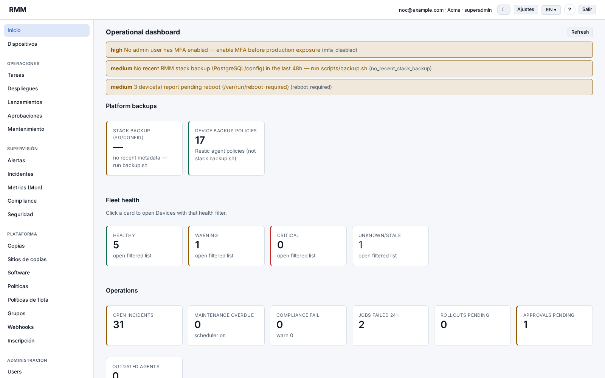
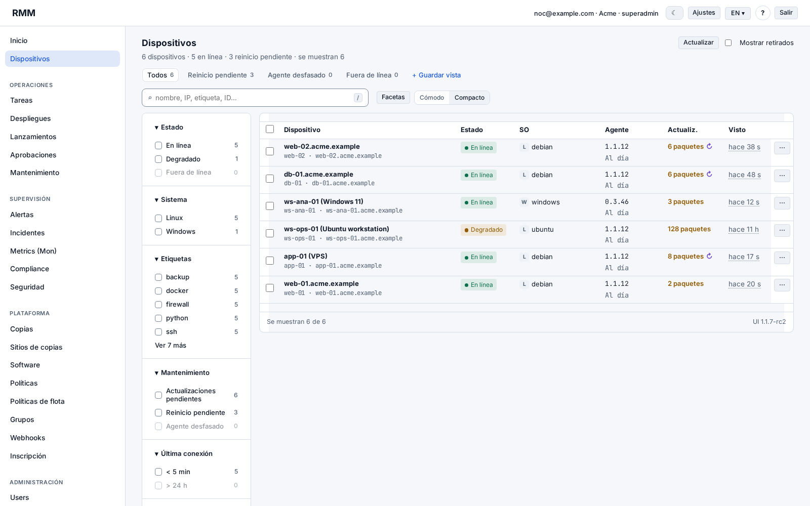
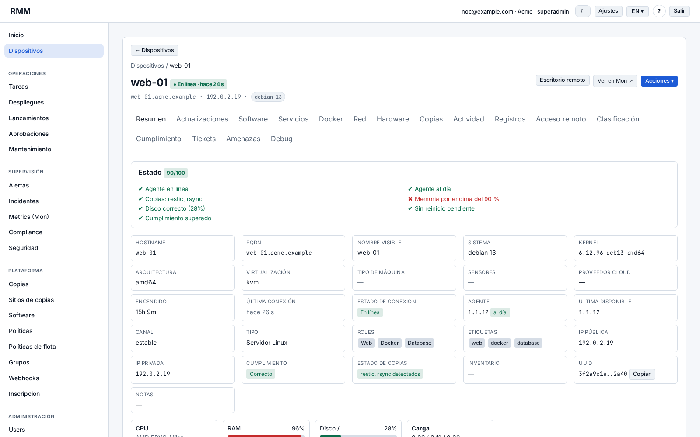
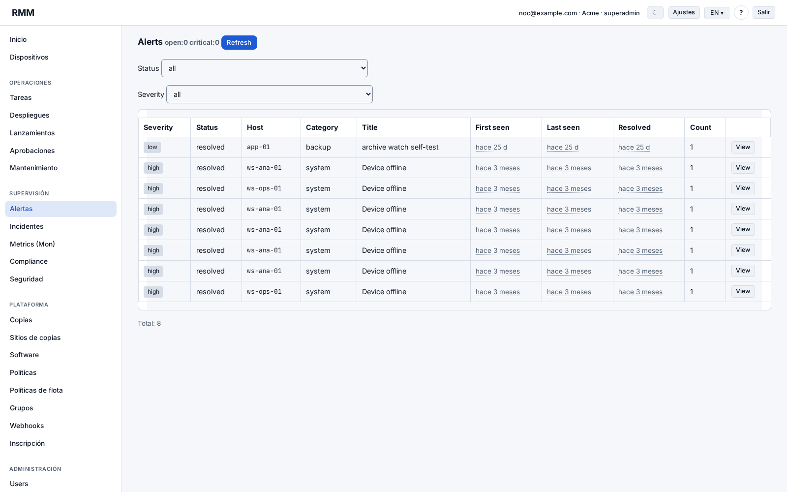
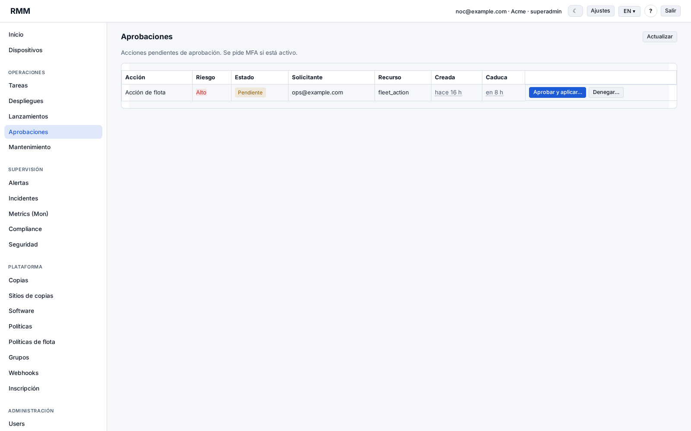
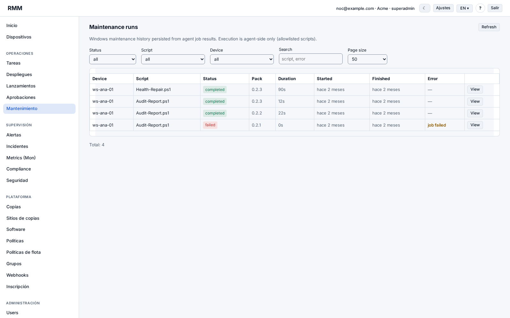

# RMM System

A self-hosted Remote Monitoring and Management platform for Linux and Windows servers and workstations, paired with a dedicated monitoring stack (Mon). Lightweight agents enroll into a central control plane: a backend API, a web operator panel, and PostgreSQL as the system of record. Operators inventory the fleet, run remote jobs and updates, apply policies, manage backups, and open remote-assistance sessions, while Mon collects metrics and logs from those same hosts.

Built and maintained for production use.

> Public overview repository. Source code and production infrastructure are private.

## Supported platforms

- **Linux (current):** Debian/Ubuntu-style hosts, servers and workstations. The agent runs as a systemd service, uses apt for package operations, and is distributed for amd64 and arm64. A local tray can open the agent console on desktop systems.
- **Windows (current):** Windows 10, Windows 11, and Windows Server, as a single binary with the same behaviour across editions. The agent runs as a system service, with a user-session tray. Enrollment is supported via command line, a setup wizard, a silent MSI, or a GPO-oriented script. Inventory distinguishes server vs workstation.
- **macOS:** planned; not implemented in the current agent repositories.

## Components

- **Linux agent** — Go daemon on managed hosts. Enrolls with a token, heartbeats over HTTPS, polls and executes jobs, collects inventory, and can apply monitoring, backup, and remote-access modules.
- **Windows agent** — Go service plus tray for the same control-plane protocol: enroll, heartbeat, inventory, jobs, and maintenance packs (winget, Windows Update, DISM/SFC, health and security scripts).
- **Agent UI** — Shared local console (embedded loopback web UI) used by both agents. It surfaces status, logs, configuration (without secrets), modules, remote assistance, backups, support, maintenance, and threat views, for the user at the keyboard.
- **Backend / API** — Go HTTP control plane. It is the system of record for devices, jobs, fleet actions, policies, approvals, backups, and audit. Agents only poll; they do not run a distributed scheduler. After enrollment, agents authenticate to the API over HTTPS with JWT.
- **Web panel** — Central operator dashboard (HTML, CSS, and vanilla JavaScript). Device list and detail, jobs, alerts, incidents, maintenance, fleet and rollouts, backups, software, groups, policies, compliance, security, users, and tenants. The interface is available in English and Spanish, with light and dark themes.
- **Mon (monitoring stack)** — Separate data plane, not a second copy of the RMM. Grafana Alloy (and related exporters) run on managed endpoints under RMM control. A central stack provides Prometheus, Grafana, Loki, and Alertmanager, with blackbox and SNMP exporters as needed. RMM installs, configures, and checks compliance of endpoint collectors and firewall allowlists; it does not own Prometheus targets, dashboards, or alert rules.
- **Orchestration** — Docker Compose definitions for the RMM control plane (reverse proxy, web UI, backend, PostgreSQL) and for Mon. Images are pulled pre-built from a private container registry and pinned by digest. Agent binaries are published as versioned artifacts and installed on hosts; targets are not expected to compile from source.

## Architecture

High-level agent-to-control-plane flow (conceptual; not a network diagram).

## Features

### Inventory and health

- Lightweight heartbeats for liveness, plus scheduled or on-demand full inventory.
- Hardware, software, services, network, Docker, security posture, and pending OS updates (apt on Linux; Windows inventory includes edition, build, and reboot-pending).
- Inventory diffs, stale-inventory warnings, and device classification/compliance views in the panel.

### Remote actions, updates, and maintenance

- Job-based remote actions with risk-based approvals and optional MFA at approve time. Lower-risk reads can run immediately; effectful work (upgrades, restarts, reboots, agent updates, restores) goes through the approval flow.
- Linux: apt update/upgrade/autoremove, full upgrade with an optional reboot afterwards, allowlisted software install/remove, service restart, log collection, and an allowlisted maintenance pack (safe / standard / full).
- Windows: winget list and upgrade (including upgrade-all), DISM and SFC health/repair, reboot, and maintenance packs covering updates, cleanup, health, security, and audit.
- Agent self-update with checksum verification, backup of the previous binary, and rollback on Linux. Fleet-wide agent rollouts can target outdated agents.
- Reboot is a first-class job on both operating systems. A reboot is treated as complete only after the agent reconnects with a new boot identifier, not merely when the shutdown command returns.

### Fleet, policies, and execution modes

- Fleet actions run the same job across many devices (by role, group, or explicit selection), with progress, cancel, and retry-failed.
- Bulk and fleet runs can be dispatched in **parallel batches** or in **cluster-safe** mode (one host at a time) so clustered services are not taken down together.
- Device groups and fleet policies (maintenance, compliance, backup) resolve in order: device, then group, then tenant.
- An optional scheduler can enqueue due work; optional auto-remediation is available behind a separate enablement flag.
- Multi-tenant isolation, role-based access, audit logging, enroll tokens, device quarantine, and decommission/recommission/purge.

### Monitoring and alerts

- RMM monitoring profiles install and reconcile endpoint collectors (Grafana Alloy, node or Windows exporters, and related units), check desired vs actual state (compliant, drift, failed), and update firewall allowlists for scraper IPs in a two-phase add/remove flow.
- The operator panel has alerts, incidents, and a link into Mon for metrics and dashboards.
- Operational warnings, security-oriented checks (for example SSH configuration, listening ports, accounts, and fail2ban on Linux), and webhooks.

### Backups

- **restic** — file backups on Linux: policy-driven preflight, backup, snapshot listing, check, retention, and restore to a new temporary directory (not over a live data path).
- **pgBackRest** — PostgreSQL backups with point-in-time recovery, scheduled from the service the database belongs to, with approval-gated restore and provision/apply.
- **UrBackup** — RMM orchestrates the endpoint client and records backup sites; the backup data itself stays on the UrBackup server. RMM does not store those copies.
- Backup policies, run history, and verified restores are visible in the panel. Secrets and repository credentials are referenced and redacted, not shown in ordinary API or UI responses. Selected backup secrets are stored in encrypted form (age envelopes).

### Remote access

- Self-hosted **RustDesk** integration: install and configure the client from desired state, with a consent prompt on workstations and audited remote sessions from the device panel.
- Credentials are masked in the UI and revealed only through an audited action.

### Security and administration

- Approvals queue, users and tenants, API tokens, CSRF-protected sessions, and optional MFA.
- Linux fail2ban status and ban/unban as fleet or device jobs.
- Software catalog and compliance profiles for common host roles.

## Screenshots

## Tech stack

- **Languages:** Go for the backend and both agents; HTML, CSS, and vanilla JavaScript for the operator panel and the local agent console.
- **Backend libraries:** Gorilla Mux, Viper, Logrus, PostgreSQL via pgx, JWT for agent and session authentication.
- **Data store:** PostgreSQL, with row-level security for tenant isolation.
- **Endpoint packaging:** systemd and a Debian-style install path on Linux; MSI / setup wizard / service + tray on Windows.
- **Containers and delivery:** Docker Compose for the control plane and for Mon; images and agent artifacts are built in CI, stored in a private registry, and deployed by digest or checksum — not compiled on the managed hosts.
- **Monitoring:** Prometheus, Grafana, Loki, Alertmanager, and Grafana Alloy, with optional blackbox and SNMP exporters.
- **Backup and remote access engines (orchestrated, not reimplemented):** restic, pgBackRest, UrBackup, and RustDesk.

## Status

In production for Linux and Windows fleet monitoring, remote management, backups, and observability. Broader platform work (including a future macOS agent) may continue in private repositories.

## Notes

This repository is a public overview only. Source code, deployment details, and private infrastructure are not exposed. Example commands, ports, and bootstrap material are omitted here.

## Contact

[LinkedIn](https://www.linkedin.com/in/joel-domenech/)
